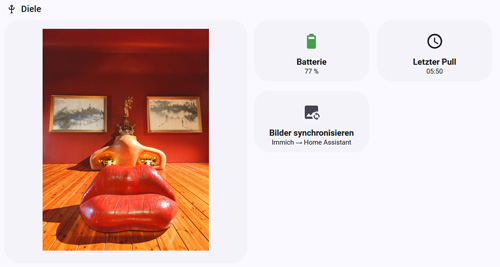

# 📖 Table of content

- [📖 Table of content](#-table-of-content)
- [✨ Features](#-features)
- [🧩 Requirements](#-requirements)
- [📦 Installation](#-installation)
  - [Option A: Installation via HACS (recommended)](#option-a-installation-via-hacs-recommended)
  - [Option B: Manual installation](#option-b-manual-installation)
- [⚙️ Configuration](#️-configuration)
  - [Multi-device configuration](#multi-device-configuration)
    - [Finding the device ID](#finding-the-device-id)
  - [Image directory layout](#image-directory-layout)
  - [Configuration of the BLOOMIN8 picture frame](#configuration-of-the-bloomin8-picture-frame)
    - [Option 1: Using cURL](#option-1-using-curl)
    - [Option 2: Using the BLOOMIN8 smartphone app](#option-2-using-the-bloomin8-smartphone-app)
  - [Testing](#testing)
- [⚠️ Breaking changes in 0.2.x](#️-breaking-changes-in-02x)
  - [Migration from 0.1.x](#migration-from-01x)
  - [Recent-image history](#recent-image-history)
- [Pull Control / Vacation Mode](#pull-control--vacation-mode)
  - [Switch Entity](#switch-entity)
  - [Behaviour when pulling is disabled](#behaviour-when-pulling-is-disabled)
- [🚫 Limitations](#-limitations)
- [📊 Entities](#-entities)
  - [Example for a Home Assistant dashboard integration](#example-for-a-home-assistant-dashboard-integration)
- [🧠 Application examples](#-application-examples)
- [🛠️ Development \& status](#️-development--status)
- [🐞 Report a bug](#-report-a-bug)
- [🙏 Note](#-note)

# ✨ Features

`bloomin8_pull` is a custom integration for Home Assistant that allows content for one or more [**BLOOMIN8 e-ink picture frames**](https://www.bloomin8.com/) to be retrieved from the Home Assistant server using a pull mechanism. It implements the [Schedule Pull API](https://github.com/ARPOBOT-BLOOMIN8/eink_canvas_home_assistant_component/blob/main/docs/Schedule_Pull_API.md) that BLOOMIN8 has provided as a code example. The official [BLOOMIN8 integration](https://github.com/ARPOBOT-BLOOMIN8/eink_canvas_home_assistant_component?tab=readme-ov-file) is independent of this. It is not required for this integration, but can of course be installed independently.

The integration is aimed in particular at users who do not just want to use BLOOMIN8 as a passive picture frame, but want to control content, status, or image changes **automatically and context-dependently**. It was created primarily out of my personal desire to be able to display images locally on the frame.

- Pull-based retrieval of locally stored images
- Support for **multiple BLOOMIN8 frames** using their `device_id`
- Per-device name, orientation and wake-up schedule
- Separate portrait and landscape image pools
- Per-device battery, pull status and enable/disable entities
- Per-device recent-image history to reduce repetitions
- Per-device publish directories so parallel frame pulls cannot delete each other's images
- Persistent state and `pull_id` → `device_id` tracking for `/eink_signal`
- Local communication (no cloud requirement)

# 🧩 Requirements

- Home Assistant **2024.12** or newer. I personally always work on the current version of Home Assistant, so I cannot guarantee compatibility with older versions.
- Each BLOOMIN8 picture frame must be able to access the Home Assistant server.
- Images must already be optimized for the target frame: correct resolution, JPEG format and suitable color/brightness adjustments for the Spectra 6 display.
- Starting with 0.2.0, images are expected in `portrait/` and `landscape/` subdirectories below `image_dir`.
- In my setup, I synchronize favorites from a local [Immich](https://immich.app/) server and optimize them automatically. I published the [sync script](https://github.com/fwmone/home-assistant-gists/blob/main/immich_sync_favorites/immich_sync_favorites.sh), its [usage instructions](https://github.com/fwmone/home-assistant-gists?tab=readme-ov-file#immich_sync_favorites), and the [eink-optimize](https://github.com/fwmone/eink-optimize) service separately.
- The images must use the `.jpg` suffix.

# 📦 Installation

## Option A: Installation via HACS (recommended)

1. Open **HACS → Integrations**
2. Click on **"Custom Repositories"**
3. Add this repository: https://github.com/fwmone/bloomin8_pull, Category: **Integration**
4. Install **BLOOMIN8 Pull**
5. Restart Home Assistant

## Option B: Manual installation

1. Download this repository
2. Copy the `custom_components/bloomin8_pull` folder to `<config>/custom_components/bloomin8_pull` (usually `/config/custom_components`)
3. Restart Home Assistant

# ⚙️ Configuration

The integration is currently configured **via YAML** in `configuration.yaml`.

## Multi-device configuration

Starting with 0.2.0, frames are configured below `devices:`. The dictionary key is the BLOOMIN8 `device_id` sent by that frame when calling `/eink_pull`.

```yaml
bloomin8_pull:
  access_token: !secret bloomin8_pull_token

  image_dir: /media/bloomin8
  publish_dir: /config/www/bloomin8
  publish_webpath: /local/bloomin8

  devices:
    "DEVICE_ID_DIELE":
      name: Diele
      orientation: P
      wake_up_hours: "6,17"

    "DEVICE_ID_TREPPE_1":
      name: Treppe 1
      orientation: L
      wake_up_hours: "7,12,18"
```

|key|scope|explanation|
|---|---|---|
|`access_token`|global|Token specified by you and configured on the frame. Using `!secret bloomin8_pull_token` is recommended.|
|`image_dir`|global|Root directory containing the `portrait/` and `landscape/` image pools.|
|`publish_dir`|global|Filesystem root below `/config/www` used to publish the image selected for each frame. The integration creates one subdirectory per `device_id`.|
|`publish_webpath`|global|Web-path counterpart of `publish_dir`, e.g. `/local/bloomin8`. The device-specific path is appended automatically.|
|`devices`|global|Map of allowed BLOOMIN8 device IDs. At least one device must be configured. Unknown device IDs are rejected.|
|`name`|per device|Friendly name used in Home Assistant entity names, e.g. `Diele`.|
|`orientation`|per device|`P` = portrait, `L` = landscape. Determines whether the frame uses the `portrait/` or `landscape/` image pool.|
|`wake_up_hours`|per device|Comma-separated local hours, e.g. `"6,17"`. The integration compensates for the frame waking up to 30 minutes early and then skips the near time slot instead of scheduling it again.|

For the access token in `secrets.yaml`:

```yaml
bloomin8_pull_token: "<YOUR_TOKEN_HERE>"
```

### Finding the device ID

There's two ways: 

1. The `device_id` is sent by the frame as part of its `/eink_pull` request. If a frame calls the endpoint with a device ID that is not listed under `devices:`, the integration responds with HTTP 400 and logs the unknown ID. This makes it easier to identify and add a new frame deliberately instead of silently accepting it.
2. Use the BLOOMIN8 smartphone app, go to "devices", open your device, go to settings (cogwheel), then "about canvas" - the serial number is its device id.

## Image directory layout

The configured `image_dir` is now (since version 0.20) a **root directory**. The integration automatically selects a subdirectory according to each frame's `orientation`:

```text
/media/bloomin8/
├── portrait/
│   ├── image-a.jpg
│   └── image-b.jpg
└── landscape/
    ├── image-c.jpg
    └── image-d.jpg
```

`orientation: P` reads from `portrait/`, while `orientation: L` reads from `landscape/`.

The published images are also separated by device. For example:

```text
/config/www/bloomin8/
├── DEVICE_ID_DIELE/
│   └── 2026-09-26-06-00-00_DEVICE_ID_DIELE_P.jpg
└── DEVICE_ID_TREPPE_1/
    └── 2026-09-26-07-00-00_DEVICE_ID_TREPPE_1_L.jpg
```

Only the current published image inside that device's directory is kept. One frame therefore cannot delete another frame's image while it is still downloading it.

## Configuration of the BLOOMIN8 picture frame

There's two days to do this:

### Option 1: Using cURL

The [BLOOMIN8 Schedule Pull API documentation](https://github.com/ARPOBOT-BLOOMIN8/eink_canvas_home_assistant_component/blob/main/docs/Schedule_Pull_API.md) contains the relevant service under `1. Device Endpoint: /upstream/pull_settings`. For configuration, the picture frame must be accessible via Wi-Fi, so it must be woken up via the BLOOMIN8 mobile app before the service can be accessed. Once configured, it automatically wakes up at the time returned in `next_cron_time` and connects to the Home Assistant server.

Example:

```json
PUT http://{device_ip}/upstream/pull_settings
Content-Type: application/json

{
    "upstream_on": true,
    "upstream_url": "http://<IP-AND-PORT-OF-HOME-ASSISTANT>",
    "token": "<YOUR_TOKEN_HERE>",
    "cron_time": "2025-11-01T08:30:00Z"
}
```

On Windows cmd it looks like this:

```bash
curl -X PUT "http://{device_ip}/upstream/pull_settings" -H "Content-Type: application/json" -d "{\"upstream_on\":true,\"upstream_url\":\"http://<IP-AND-PORT-OF-HOME-ASSISTANT>\",\"token\":\"<YOUR_TOKEN_HERE>\",\"cron_time\":\"2025-11-01T08:30:00Z\"}"
```

Use for `IP-AND-PORT-OF-HOME-ASSISTANT`, for example, `http://192.168.0.1`. The frame then automatically appends the path to the pull service.

### Option 2: Using the BLOOMIN8 smartphone app

Go to "devices", open your device, go to settings (cogwheel), then scroll to "upstream configuration" - provide the required data

## Testing

When testing 0.2.x, use a `device_id` that is actually configured under `devices:`. Unknown IDs are intentionally rejected.

Test whether the custom component works and provides the pull service:

```bash
curl -i -H "X-Access-Token: <YOUR_TOKEN_HERE>" "http://<IP-AND-PORT-OF-HOME-ASSISTANT>/eink_pull?device_id=<CONFIGURED_DEVICE_ID>&pull_id=test-uuid&cron_time=2026-01-04T09:00:00Z&battery=80"
```

Test whether the success callback can be associated with the preceding pull:

```bash
curl -i -H "X-Access-Token: <YOUR_TOKEN_HERE>" "http://<IP-AND-PORT-OF-HOME-ASSISTANT>/eink_signal?pull_id=test-uuid&success=1"
```

The `pull_id` is registered during `/eink_pull`, associated with the calling device and consumed by `/eink_signal`. Outstanding mappings are persisted and expire after 24 hours.

To configure the frame itself:

```bash
curl -X PUT "http://<IP-OF-BLOOMIN8-FRAME>/upstream/pull_settings" -H "Content-Type: application/json" -d "{\"upstream_on\":true,\"upstream_url\":\"http://<IP-AND-PORT-OF-HOME-ASSISTANT>\",\"token\":\"<YOUR_TOKEN_HERE>\",\"cron_time\":\"2026-01-17T05:00:00Z\"}"
```

`cron_time` must be UTC time.

# ⚠️ Breaking changes in 0.2.x

Version 0.2.0 changes the integration from a single shared frame state to a real **multi-device configuration**. Versions 0.2.1 and 0.2.2 refine entity handling and naming for YAML-based setups.

The following changes require attention when upgrading from 0.1.x:

- `wake_up_hours` and `orientation` are no longer global options. They must be configured **for each frame** below `devices:`.
- `devices:` is mandatory and keyed by the actual BLOOMIN8 `device_id`.
- `image_dir` now points to a root directory containing `portrait/` and `landscape/` subdirectories.
- State is tracked independently for every configured frame.
- Pull enable/disable is per frame rather than global.
- Recent-image history is per frame rather than shared.
- Published images are stored in per-device subdirectories below `publish_dir`.
- `/eink_signal` is assigned to the correct frame through the preceding `pull_id` from `/eink_pull`.
- Unknown `device_id` values are rejected instead of being handled through global defaults.
- Entity names and IDs change. 0.2.2 uses the `bloomin8_pull` prefix to avoid collisions with entities from the official BLOOMIN8 integration. Please check your lovelace boards, scripts and automations after updating.

## Migration from 0.1.x

A typical 0.1.x configuration such as:

```yaml
bloomin8_pull:
  access_token: !secret bloomin8_pull_token
  image_dir: /media/bloomin8
  publish_dir: /config/www/bloomin8
  publish_webpath: /local/bloomin8
  wake_up_hours: "6,18"
  orientation: P
```

must become, for example:

```yaml
bloomin8_pull:
  access_token: !secret bloomin8_pull_token
  image_dir: /media/bloomin8
  publish_dir: /config/www/bloomin8
  publish_webpath: /local/bloomin8

  devices:
    "YOUR_REAL_DEVICE_ID":
      name: Diele
      orientation: P
      wake_up_hours: "6,18"
```

Before restarting Home Assistant, make sure your image files are present in the corresponding orientation directory, e.g.:

```text
/media/bloomin8/portrait/
```

The existing `/config/bloomin8_pull_state.json` is migrated automatically: if a legacy 0.1.x state is detected, it is assigned to the **first configured device**. If you had effectively used multiple frames with the old shared state, only that one legacy state can be migrated automatically.

Because the new entities use per-device unique IDs and new names, old 0.1.x entities can remain as orphaned entries in Home Assistant's Entity Registry. After verifying 0.2.x, remove the obsolete entities from **Settings → Devices & services → Entities** if necessary.

Typical new entity IDs are:

```text
sensor.bloomin8_pull_diele_battery
binary_sensor.bloomin8_pull_diele_last_pull_success
switch.bloomin8_pull_diele_pull_enabled
```

## Recent-image history

0.1.x used one shared Home Assistant `Store` for recently displayed images. 0.2.x creates a separate store per device, using a key based on the `device_id`, for example:

```text
/config/.storage/bloomin8_pull_recent_images_DEVICE_ID_DIELE
```

This history is **not migrated automatically**. Starting with an empty per-device history is safe; it only means that recently displayed images may appear again sooner after the upgrade. If you explicitly want to preserve the old history for one frame, you can copy the old `recent` list into that frame's new store while Home Assistant is stopped. Editing `.storage` manually is optional and should only be done with a backup and with Home Assistant shut down. The file format stayed the same, so, if you'd like to, just copy the old `/config/.storage/bloomin8_pull_recent_images` to `/config/.storage/bloomin8_pull_recent_images_DEVICE_ID_DIELE`, open the file and change `"key": "bloomin8_pull_recent_images"` to `"key": "bloomin8_pull_recent_images_D5D9A2A227EA75538CB0EFFFD120A1EA"`. 

# Pull Control / Vacation Mode

Each configured frame has its own enable/disable switch. This is useful during vacations or longer absences where image rotation on a specific frame is not desired.

## Switch Entity

For a frame named `Diele`, the integration typically creates:

- `switch.bloomin8_pull_diele_pull_enabled`

| State | Behaviour |
|---|---|
| `on` (default) | Normal pull behaviour; a new image is selected for this frame |
| `off` | No new image is selected; the frame receives its previously published image again |

The switch state is persisted independently for every configured device and survives Home Assistant restarts.

## Behaviour when pulling is disabled

When a disabled BLOOMIN8 device calls `/eink_pull`:

- no new image is selected
- the last image URL for **that device** is returned again
- `next_cron_time` is still provided
- if no previous image exists yet, the endpoint returns status 204 in the JSON body together with the next wake-up time

This ensures that the currently displayed image remains unchanged and that images are not unnecessarily rotated during an absence.

The last displayed image URL is exposed as an attribute on the frame's binary sensor, e.g.:

- `binary_sensor.bloomin8_pull_diele_last_pull_success`
  - attribute: `last_image_url`

# 🚫 Limitations

- Configuration is currently YAML-based; there is no Config Flow yet.
- Frames must use a `device_id` explicitly listed in the YAML configuration.
- Image preprocessing is intentionally out of scope. Files must already be JPEGs suitable for the frame.
- The integration separates images by orientation only (`portrait` / `landscape`). More complex per-frame content pools are currently not implemented.

# 📊 Entities

For **each configured frame**, the integration creates three entities. For a device named `Diele`, Home Assistant will typically create:

- `sensor.bloomin8_pull_diele_battery` — battery level reported during `/eink_pull`
- `binary_sensor.bloomin8_pull_diele_last_pull_success` — result of the most recent `/eink_signal`; attributes include `last_seen`, `last_image_url` and `device_id`
- `switch.bloomin8_pull_diele_pull_enabled` — enables or pauses image rotation for this device

Entity `unique_id` values are based on the immutable BLOOMIN8 `device_id`, while the friendly device `name` is used for the entity name. This keeps the internal identity stable even if the friendly name changes.

## Example for a Home Assistant dashboard integration



Shows last provided image, battery value, last frame sync, last push time and next sync time. I use the super handy [button cards](https://github.com/custom-cards/button-card), that need to be installed beforehand. You can find the Immich image sync script of the third button [here](https://github.com/fwmone/home-assistant-gists#immich_sync_favorites). 

```yaml
type: grid
cards:
  - type: heading
    icon: mdi:coat-rack
    heading: Diele
    heading_style: title
  - type: markdown
    content: >-
      
        
          <a href="{{ url[url.find('/local'):] }}" target="_blank">
        
          'Keine Bild-URL vorhanden'
        
    card_mod:
      style:
        ha-markdown$: |
          p {
            margin-bottom: 0 !important;
            text-align: center;
          }
  - type: custom:layout-card
    layout_type: grid
    layout:
      grid-template-columns: 1fr 1fr
      grid-gap: 6px
      margin: -8px 0 0 0;
      card_margin: 0 0 0 0;
    cards:
      - type: custom:button-card
        entity: sensor.bloomin8_pull_diele_battery
        name: Batterie
        show_state: true
        show_label: true
        layout: icon_name_state2nd
        icon: |
          [[[
            let level = parseInt(entity.state);

            if (entity.state === "unavailable" || entity.state === "unknown")
              return "mdi:battery-unknown";

            if (isNaN(level)) return "mdi:battery-unknown";

            if (level <= 5) return "mdi:battery-outline";
            if (level <= 10) return "mdi:battery-10";
            if (level <= 20) return "mdi:battery-20";
            if (level <= 30) return "mdi:battery-30";
            if (level <= 40) return "mdi:battery-40";
            if (level <= 50) return "mdi:battery-50";
            if (level <= 60) return "mdi:battery-60";
            if (level <= 70) return "mdi:battery-70";
            if (level <= 80) return "mdi:battery-80";
            if (level <= 90) return "mdi:battery-90";
            return "mdi:battery";
          ]]]
        styles:
          icon:
            - height: 32px
            - color: |
                [[[
                  let level = parseInt(entity.state);
                  if (level <= 20) return "var(--label-badge-red)";
                  if (level <= 55) return "var(--label-badge-yellow)";
                  return "var(--label-badge-green)";
                ]]]
          card:
            - border-radius: 28px
            - padding: 10px
            - height: 110px
          grid:
            - grid-template-areas: '"i" "n" "s"'
            - grid-template-columns: 1fr
            - grid-template-rows: 1fr min-content min-content
          name:
            - justify-self: center
            - font-weight: bold
            - font-size: 0.9em
          state:
            - justify-self: center
            - font-size: 12px
            - padding-top: 1px
        tap_action:
          action: more-info
      - type: custom:button-card
        entity: sensor.bloomin8_letzter_pull
        name: Letzter Pull
        show_state: true
        show_label: true
        layout: icon_name_state2nd
        styles:
          icon:
            - height: 32px
          card:
            - border-radius: 28px
            - padding: 10px
            - height: 110px
          grid:
            - grid-template-areas: '"i" "n" "s"'
            - grid-template-columns: 1fr
            - grid-template-rows: 1fr min-content min-content
          name:
            - justify-self: center
            - font-weight: bold
            - font-size: 0.9em
          state:
            - justify-self: center
            - font-size: 12px
            - padding-top: 1px
        tap_action:
          action: more-info
      - type: custom:button-card
        entity: script.immich_favoriten_synchronisieren
        name: Bilder synchronisieren
        icon: mdi:image-sync
        show_state: false
        show_label: true
        layout: icon_name_state2nd
        label: |
          [[[
            if (entity.state === "on") {
              return "Synchronisierung läuft …";
            }
            return "Immich → Home Assistant";
          ]]]
        tap_action:
          action: call-service
          service: script.turn_on
          service_data:
            entity_id: script.immich_favoriten_synchronisieren
        hold_action:
          action: more-info
        state:
          - value: 'on'
            icon: mdi:sync
            styles:
              icon:
                - animation: rotating 1.5s linear infinite
              card:
                - opacity: 0.75
        extra_styles: |
          @keyframes rotating {
            from {
              transform: rotate(0deg);
            }
            to {
              transform: rotate(360deg);
            }
          }
        styles:
          icon:
            - height: 32px
          card:
            - border-radius: 28px
            - padding: 10px
            - height: 110px
          grid:
            - grid-template-areas: '"i" "n" "l"'
            - grid-template-columns: 1fr
            - grid-template-rows: 1fr min-content min-content
          name:
            - justify-self: center
            - font-weight: bold
            - font-size: 0.9em
          label:
            - justify-self: center
            - font-size: 12px
            - padding-top: 1px
column_span: 2
```

# 🧠 Application examples

- Automatic image change depending on time of day or weather
- Display of context-related content (e.g., calendar, notes, moods)
- Integration into existing smart home scenarios

# 🛠️ Development & status

This integration is currently under active development. 
Feedback, bug reports, and pull requests are welcome.

# 🐞 Report a bug

Please use the issue tracker on GitHub:

👉 https://github.com/fwmone/bloomin8_pull/issues

# 🙏 Note

This integration has no official connection to the manufacturer of BLOOMIN8.